# K-Beauty 글로벌 랭킹 큐레이션 서비스 기획 및 아키텍처 계획서

> **문서 목적**: 한국 주요 화장품 및 면세 뷰티 채널의 인기 순위(Top 20)를 주간 단위로 수집·다국어 번역·관리자 검수 후 제공하는 글로벌 웹 서비스 구축 및 **Google AdSense 승인·운영**을 위한 마스터 플랜.

---

## 1. 프로젝트 개요 및 목표

### 1.1 서비스 비전
- **핵심 컨셉**: 한국 화장품(K-Beauty)에 관심이 많거나 한국 여행을 준비하는 **외국인 타겟**으로, *"한국에 오면 사야 할 인기 화장품 랭킹 + 블로그형 리뷰·쇼핑 가이드"*를 제공하는 **글로벌 K-Beauty 큐레이션 미디어**.
- **주요 목표**:
  1. **미국/글로벌(`en`) · 중국(`zh-CN`) · 대만(`zh-TW`) · 일본(`ja`)** 4개 외국어권 사용자 중심 서비스 제공 *(Public 사이트에서 한국어 `ko`는 제외하고, 원문 데이터 및 `/admin` 검수용으로만 내부 유지)*
  2. 단순 순위 나열을 넘어 **방한 쇼핑 가이드·제품 리뷰 블로그**를 결합해 **Google AdSense 승인** 기준(오리지널 고부가가치 콘텐츠) 충족
  3. 주 1회 자동 수집 → JSON 저장 → 4개국어 번역 → 관리자 승인(JSON 편집) → Git 자동 커밋/배포로 이어지는 **DB 비용 0원·반자동 운영 파이프라인** 구축
  4. 초기 **Vercel 무료(Hobby) 티어**로 운영 시작 후, 트래픽 증가 시 **Cloudflare Workers** 기반 아키텍처로 무중단 확장

---

## 2. 수집 대상 채널 및 PoC 검증 결과

> 올리브영(`oliveyoung.co.kr`) 및 더페이스샵(`thefaceshop.com`)은 기획 범위에서 **제외**하고, 아래 5개 후보 채널에 대해 사전 기술 검증(2026-11-14)을 완료했다.

### 2.1 채널별 크롤링 가능성 검증 결과

| ID | 채널명 | 기준 URL | HTTP / `robots.txt` | 렌더링 & 추출 방식 | 이미지 핫링크 | 수집 가능 여부 |
| :--- | :--- | :--- | :--- | :--- | :---: | :---: |
| `missha` | **미샤** | `https://missha.com/kr/best/bestseller` | `200` / `Allow: /` | jQuery/AJAX 동적 로딩(CSR) | 확인 필요 | **가능** (Playwright / AJAX API) |
| `daisomall` | **다이소몰** | `https://www.daisomall.co.kr/ds/diy2/C115` | `200` / 봇 허용(`Crawl-delay: 5~10`) | Nuxt.js (`window.__NUXT__` + 클라이언트 API) | `200 OK` | **가능** (Playwright / 내부 API) |
| `lottedfs` | **롯데면세점** | `https://kor.lottedfs.com/kr/display/category/first?dispShopNo1=10031760&treDpth=1` | `200` / 주요 봇 허용 | **SSR HTML 직접 포함** (975KB, `$` 가격/상품 내장) | `200 OK` (`webp`) | **매우 용이** (Cheerio 가능) |
| `ssgdfs` | **신세계면세점** | `https://www.ssgdfs.com/kr/dispctg/ctg/beauty` | **`406`** / `Allow: /` | 안티봇 JS 챌린지 (`/_fec_sbu/fec_wrapper.js`) | - | **자동 수집 불가** (수동/대체 필요) |
| `shilladfs` | **신라면세점** | `https://m.shilladfs.com/estore/kr/ko/p/5549192` | **`403`** / 일부 Disallow | Cloudflare 봇 챌린지 (`Just a moment...`) | - | **자동 수집 불가** (수동/대체 필요) |

> [!WARNING]
> **신세계면세점(`406`)·신라면세점(`403`)**은 안티봇 챌린지로 차단되어 자동 크롤링 우회를 시도하지 않는다. 자동 수집 파이프라인은 1차로 **미샤·다이소몰·롯데면세점(3개 채널)**을 기본 탑재하고, 필요 시 관리자 페이지(`/admin`)의 **JSON 직접 입력/CSV 업로드**로 추가 채널 데이터를 병행한다.

### 2.2 화면별 노출 수량 정책
- **사이드 메뉴 (채널별 전용 뷰)**: 각 채널당 **상위 20개(Top 20)** 전체 리스트 제공
- **메인 페이지 (종합 대시보드)**: 각 채널별 핵심 **상위 10~20개** 노출 (초기 기본값 Top 10, 설정으로 10~20개 조절 가능)

### 2.3 표준 상품 데이터 스키마 (Git JSON)
채널별(국내몰 `KRW` / 면세점 `USD`) 가격 단위를 수용할 수 있도록 단일 스키마로 정규화한다.

```json
{
  "snapshot_id": "2026-W46",
  "channel": "lottedfs",
  "rank": 1,
  "rank_delta": 2,
  "source_product_id": "5549192",
  "product_url": "https://kor.lottedfs.com/...",
  "image_url": "https://static.lottedfs.com/...",
  "currency": "USD",
  "price": 38,
  "sale_price": 32.3,
  "brand": {
    "ko": "설화수",
    "en": "Sulwhasoo",
    "ja": "ソルファス",
    "zh-CN": "雪花秀",
    "zh-TW": "雪花秀"
  },
  "name": {
    "ko": "윤조에센스 6세대 90ml",
    "en": "First Care Activating Serum VI 90ml",
    "ja": "ファーストケア アクティベーティング セラム VI 90ml",
    "zh-CN": "润致焕活肌底精华露 第6代 90ml",
    "zh-TW": "潤燥養膚精華 第6代 90ml"
  },
  "category": "skincare",
  "editorial_summary": {
    "ko": "...",
    "en": "..."
  },
  "collected_at": "2026-11-14T00:00:00Z"
}
```

---

## 3. 타겟 시장 및 다국어(i18n) 전략

### 3.1 지원 언어 및 로케일 (외국인 타겟 4개국어 중심)
> Public 서비스는 외국인 타겟에 집중하기 위해 **한국어(`/ko`)를 제외**하고 아래 4개 언어를 제공한다. (기본 진입 `/` → `/en` 리다이렉트, 내부 원본 데이터 및 `/admin` 검수 화면은 `ko` 원문 유지)

| 타겟 국가 | 로케일 코드 | URL Prefix | 표기 특징 및 주의사항 |
| :--- | :--- | :--- | :--- |
| 미국 / 글로벌 | `en` | `/en` | 기본 언어(`x-default`), 영문 공식 브랜드명/성분명 우선 표기 |
| 중국 | `zh-CN` | `/zh-CN` | 간체자 적용, 검색 유입 고려(바이두/구글) |
| 대만 | `zh-TW` | `/zh-TW` | 번체자 적용 (`zh-CN` 단순 변환 금지, 대만 뷰티 용어 반영) |
| 일본 | `ja` | `/ja` | 가타카나 브랜드 표기 및 일본 뷰티 키워드 최적화 |

### 3.2 번역 품질 및 SEO 정책
- **도메인 용어집(Glossary) 적용**: 브랜드명과 핵심 화장품 성분(나이아신아마이드, 판테놀, 시카 등)은 용어집 매핑을 우선 적용한다.
- **다국어 SEO 필수 요소**:
  - 모든 페이지에 `hreflang` 태그 (`en`, `zh-CN`, `zh-TW`, `ja`, `x-default` = `/en`) 삽입
  - 언어별 동적 `sitemap.xml` 및 `robots.txt` 생성
  - 채널 특성에 따라 `KRW`(미샤·다이소몰) / `USD`(롯데면세점) 통화 및 수집 기준일 명시

---

## 4. 정보 구조(IA) 및 UI/UX 설계

### 4.1 사이트 네비게이션 구조
- **상단 헤더**: 서비스 로고, 주간 업데이트 기준일 배지, 5개국 언어 스위처, 카테고리 필터
- **좌측 사이드 메뉴 (모바일에서는 드로어/하단 탭)**:
  - 전체 요약 (메인)
  - 미샤 Top 20
  - 다이소몰 Top 20
  - 롯데면세점 Top 20
  - *(수동 입력 시 추가 면세 채널)*
  - K-Beauty 트렌드 & 가이드 (오리지널 콘텐츠 섹션)
- **메인 페이지 구성**:
  1. 금주의 K-Beauty 요약 하이라이트 (주간 급상승 Top 아이템)
  2. 채널별 랭킹 섹션 (각 10~20개 카드 노출 + `Top 20 전체 보기` CTA)
  3. 주간 에디토리얼 리포트 요약 (AdSense 품질 확보용)

### 4.2 AdSense 승인을 위한 필수 페이지 & 콘텐츠 전략
> [!IMPORTANT]
> 단순 외부 링크와 상품명만 나열하는 사이트는 Google AdSense 심사에서 **"가치 있는 인벤토리 없음(Thin Content / Scraped Content)"** 사유로 거절될 확률이 매우 높다.

이를 방지하기 위해 다음을 반드시 포함한다.
1. **오리지널 부가가치 콘텐츠**:
   - 주간 순위 변동 요약 리포트 (예: *"이번 주 다이소몰 가성비 뷰티 vs 면세점 프리미엄 스킨케어 트렌드"*)
   - 상품별 다국어 핵심 특징·성분·피부타입 요약 설명(AI 초안 + 관리자 검수)
   - K-Beauty 쇼핑 가이드 / 화장품 용어 사전 페이지
2. **필수 신뢰·법적 페이지 (5개국어 제공)**:
   - 서비스 소개 (`About`), 문의하기 (`Contact`), 개인정보처리방침 (`Privacy Policy`), 이용약관 (`Terms of Service`), 외부 링크 및 면책 고지 (`Disclaimer`)

---

## 5. 주간 자동화 및 Git 기반 관리자 승인 파이프라인

요청된 흐름: **`주 1회 크롤링 → JSON 수집 → 다국어 번역 → 관리자 페이지 검수/편집 → 승인 시 Git 커밋/푸시 → 자동 배포`**

### 5.1 파이프라인 상세 흐름

```mermaid
flowchart LR
    A["1. 주 1회 트리거<br/>(GitHub Actions Cron)"] --> B["2. 채널 크롤링<br/>(Playwright / Cheerio)"]
    B --> C["3. 정규화 및 검증<br/>(Top 20, 이미지/링크 체크)"]
    C --> D["4. Staging JSON 저장<br/>(data/staging/*.json)"]
    D --> E["5. 관리자 페이지 접속<br/>(/admin)"]
    E --> F["6. JSON 편집 · 자동 번역<br/>상품 정보 검수"]
    F -- "승인(Approve)" --> G["7. Git Commit & Push<br/>(data/published/*.json)"]
    G --> H["8. Vercel 자동 재배포<br/>(라이브 반영)"]
```



### 5.2 단계별 세부 설계
1. **수집 (GitHub Actions Crawler)**:
   - Vercel Hobby의 실행 시간 제한(10~60초) 및 헤드리스 브라우저 불가 제약을 피하기 위해 **GitHub Actions**에서 주 1회 실행.
   - 채널별 어댑터 분리 (`adapters/missha.ts`, `adapters/daisomall.ts`, `adapters/lottedfs.ts`).
   - 수집 결과를 `data/staging/{channel}-latest.json`으로 리포지토리에 커밋(또는 PR 생성).
2. **관리자 페이지 (`/admin`)**:
   - 인증된 관리자만 접근 가능.
   - Staging JSON 데이터를 로드하여 **상품 정보(순위·이미지·가격·링크) 미리보기**, **JSON 직접 편집**, **5개국어 자동 번역 실행 및 수정** 기능 제공.
   - 크롤링 불가 채널(신세계/신라면세점 등)이 필요할 경우 관리자 UI에서 JSON/CSV 붙여넣기로 동일 스키마 생성 가능.
3. **승인 및 Git 반영 (Publish)**:
   - 관리자가 **[승인 및 Git 반영]** 버튼을 클릭하면 GitHub REST API(Octokit)를 통해 다국어 번역이 포함된 최종 JSON을 `data/published/{channel}.json` 및 `data/history/{snapshot_id}/{channel}.json` 경로로 커밋·푸시한다.
   - Vercel Git Integration이 푸시를 감지하여 즉시 프로덕션 빌드를 트리거하고 라이브 사이트에 반영한다.

---

## 6. 시스템 아키텍처 및 인프라 확장 로드맵

### 6.1 Phase 1: 초기 구축 (Vercel 무료 서버 + Git JSON 기준)
| 계층 | 기술 스택 | 선정 이유 |
| :--- | :--- | :--- |
| **프레임워크** | **Next.js (App Router, TypeScript)** | 다국어 라우팅, 정적 생성(SSG/ISR), SEO 최적화 |
| **데이터 저장소** | **Git Repository JSON** (`data/published/*.json`) | **DB 비용 0원**, Git 히스토리로 주간 스냅샷 버전 관리 |
| **호스팅** | **Vercel Hobby (Free)** | 월 100GB 대역폭, 무료 SSL, Git 푸시 시 자동 배포 |
| **배치/크롤러** | **GitHub Actions + Playwright / Cheerio** | 무료 쿼터 활용, 동적/정적 채널 안정 수집 |
| **번역 엔진** | **Gemini / OpenAI / DeepL API** | 관리자 페이지 내 온디맨드 및 차분 번역(월 비용 극소) |
| **관리자 인증/Git 연동** | **Auth.js + GitHub PAT (Octokit)** | `/admin` 접근 제어 및 승인 시 자동 커밋/푸시 |
| **스타일링** | **Tailwind CSS + shadcn/ui** | 반응형 Public UI 및 JSON/번역 편집용 Admin UI 구축 |

> [!NOTE]
> **Vercel Hobby 주의사항**: Vercel Hobby 플랜은 비상업적(Non-commercial) 기준이므로, **Google AdSense 수익화가 본격화되거나 월 대역폭(100GB) 한계에 근접할 시** Phase 2(Cloudflare Workers)로 전환한다.

### 6.2 Phase 2: 트래픽 급증 시 확장 (Cloudflare Workers 전환)
- **컴퓨팅**: **`@opennextjs/cloudflare`** 어댑터를 통해 **Cloudflare Workers**에 배포 (엣지 기반 무제한급 대역폭).
- **캐시/스토리지**:
  - **Cloudflare KV / Cache API**: 다국어 JSON 및 렌더링 페이지 엣지 캐싱.
  - **Cloudflare R2**: 이미지 핫링크 차단 대비 및 WebP 썸네일 캐싱.

---

## 7. 기술적·법적 리스크 및 대응 방안

| 리스크 영역 | 상세 내용 | 대응 전략 |
| :--- | :--- | :--- |
| **봇 차단 (WAF)** | 신세계면세점(`406`)·신라면세점(`403`)처럼 안티봇 챌린지가 적용된 사이트 존재 | PoC 통과 채널(미샤·다이소몰·롯데면세점) 중심으로 자동화하고, 차단 사이트는 관리자 수동 입력 또는 제외 |
| **이미지 핫링크 차단** | 롯데면세점·다이소몰은 `200 OK` 확인됨. 미샤 등 추후 차단 가능성 존재 | `referrerPolicy="no-referrer"` 적용 및 Admin 승인 단계에서 이미지 로드 상태 자동 검증 |
| **저작권/약관** | 상품 상세 이미지/설명 무단 복제 이슈 | 순위·가격·상품명 등 사실 데이터와 공식몰 **아웃링크** 중심 구성 + 자체 요약 코멘트 작성 |
| **AdSense 거절** | 콘텐츠 빈약, 크롤링 데이터 단순 나열 | 주간 트렌드 분석 리포트 및 K-Beauty 가이드 페이지 15개 이상 선구축 후 심사 신청 |

---

## 8. 단계별 실행 로드맵 (Milestones)

### Step 0: 사전 기술 검증 (PoC)
- [x] **1차 접근성·렌더링·핫링크 검증 완료 (2026-11-14)**:
  - 수집 가능: **미샤**(Playwright/AJAX), **다이소몰**(Playwright/Nuxt API), **롯데면세점**(SSR HTML 직접 추출)
  - 수집 불가(차단): **신세계면세점**(406 챌린지), **신라면세점**(403 Cloudflare 챌린지)
- [x] **2차 추출 PoC (부분 완료)**:
  - **롯데면세점**: `<ol id="unitStyleList">`에서 순위·브랜드·상품명·이미지·링크 **Top 20 실제 JSON 추출 성공** (Cheerio 기반 구현 확정).
  - **미샤**: `/static/js/bestseller.js`가 `/kr/best/bestseller/getBestseller` 호출 확인 (`POST 200`이나 빈 응답 반환 → 실제 상품 리스트 페이지 `/kr/product/...` 또는 Playwright 렌더링 추가 확인 필요).
  - **다이소몰**: Nuxt.js CSR 렌더링 확인 (Playwright로 DOM/네트워크 XHR API 캡처하여 Top 20 추출 어댑터 구현 예정).

### Step 1: Git JSON 구조 & 관리자 승인(`/admin`) MVP — *구현 완료 (2026-11-14)*
- [x] `data/staging/`, `data/published/`, `data/history/` JSON 스키마 및 디렉토리 구조 확정
- [x] 3개 채널 수집 어댑터(`lottedfs`, `missha`, `daisomall`) + 주간 GitHub Actions 워크플로우(`.github/workflows/weekly-crawl.yml`) 구현
- [x] `/admin` 페이지 구현 (JSON 편집기, 상품 카드 미리보기, 다국어 자동 번역, Git 커밋/푸시 승인)

### Step 2: 글로벌 프론트엔드, 블로그/가이드 & SEO 구축
- [ ] Public 라우팅 외국인 4개국어(`en`, `ja`, `zh-CN`, `zh-TW`) 중심으로 정리 및 `/` → `/en` 전환
- [ ] 메인 페이지(채널별 10~20개) 및 사이드 메뉴(채널별 Top 20) UI 고도화
- [ ] **방한 외국인 K-Beauty 쇼핑 가이드 & 블로그 리뷰 섹션** (`/[locale]/guides/[slug]`) 구축
- [ ] `hreflang`, `sitemap.xml`, `robots.txt`, 구조화 데이터(JSON-LD) 적용

### Step 3: AdSense 승인 준비 및 런칭
- [ ] 오리지널 K-Beauty 가이드/리뷰 블로그 콘텐츠 15편 이상 발행 (4개국어)
- [ ] 필수 정책 페이지(About, Contact, Privacy, Terms, Disclaimer) 4개국어 완비
- [ ] Core Web Vitals 최적화 및 Google Search Console / AdSense 심사 신청

### Step 4: 트래픽 스케일링 (Cloudflare Workers)
- [ ] 트래픽/대역폭 모니터링 및 Cloudflare Workers 전환 리허설

---

## 9. 확정 사항 및 추후 결정 필요 사항
- **확정 사항**:
  - **타겟 & 언어**: 방한/관심 외국인 대상, **4개국어(`en`, `ja`, `zh-CN`, `zh-TW`)** 중심 + 쇼핑 가이드/리뷰 블로그 결합
  - **수집 채널**: 자동 수집 3개 채널(**롯데면세점 · 미샤 · 다이소몰**) 확정
  - **데이터 저장 & 승인**: Git 기반 정적 JSON + `/admin` 편집·번역·Git 커밋 승인 구조
- **추후 결정 사항**:
  1. **제휴 마케팅(Affiliate)**: 추후 AdSense 외에 면세점/공식몰 제휴 링크 연동 여부
  2. **도메인 및 브랜딩**: 서비스 도메인명 및 4개국어 브랜드명 확정
  3. **워크플로우/트래커**: `.agents/workflows/plan.md` 규격에 따른 실행 트래커는 [001-kbeauty-ranking-platform.md](file:///Users/choi/Documents/GitHub/project-temp-ing/docs/plans/work/001-kbeauty-ranking-platform.md)에서 관리